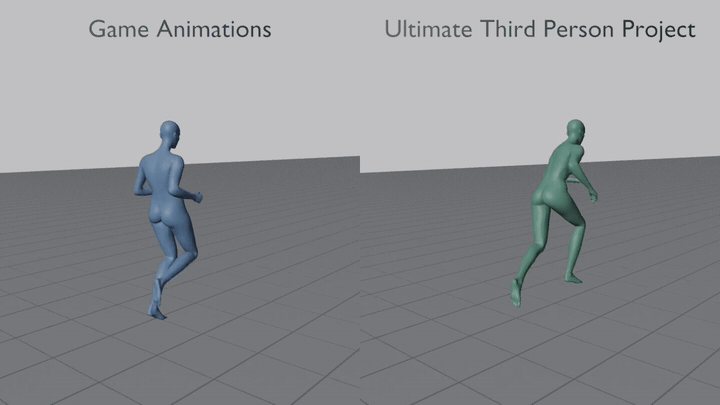
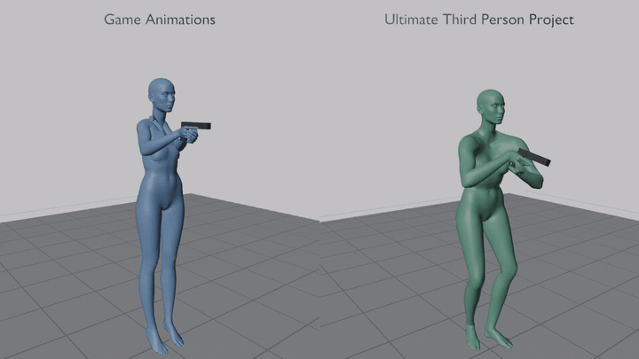
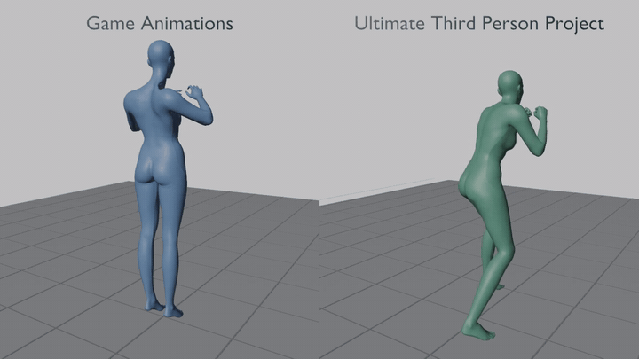

  

<b>Smoothest. Most responsive. Most immersive.</b> 
Motion Matching locomotion, natural body rotation and sharp third-person aiming and combat for Cyberpunk 2077.

  
  
  

  
  
  
  
  
  

  <a href="#quick-start">Quick start</a> ·
  <a href="#see-the-difference">See the difference</a> ·
  <a href="#features">Features</a> ·
  <a href="#requirements">Requirements</a> ·
  <a href="#how-to-report-a-problem">Report a problem</a> ·
  <a href="#for-developers">For developers</a>

## Quick start

> [!NOTE]
> Version 0.1.0 is the first public release and an early foundation. Feedback is very welcome.

1. Install the [requirements](#requirements): RED4ext, redscript, Cyber Engine Tweaks, Codeware, ArchiveXL and Input Loader.
2. Install UTPP with Vortex (**Mod manager download**) or extract the archive into the game folder.
3. Start the game and load a save. V is now in third person.
4. Optional: tune it in **Mod Settings > Ultimate Third Person**.

## See the difference

Left: the game's own animations. Right: Ultimate Third Person Project. Real-time speed.

| Run, slide, crouch | Aiming and shooting | Fists |
|:---:|:---:|:---:|
|  |  |  |

## Features

| | | |
|:---|:---|:---|
| 🏃 **Motion Matching** Locomotion picked frame by frame from a large animation database. | 🔄 **Body rotation** V turns naturally with the camera and the movement direction. | 🦶 **Foot locking** Less visible sliding on starts, stops and turns. |
| 🎯 **Aiming** The most responsive third-person aiming and shooting in the game. | 🔫 **Recoil and grip** Recoil from the game's weapon animations, left hand on the handguard, stock at the shoulder. | 🥊 **Fists** Third-person fist combat built from the game's own combat animations. |
| 🚗 **Vehicles** Third-person entering and leaving of cars and motorcycles. | ↔️ **Shoulder swap** One key on keyboard and controller, assignable in Mod Settings. | 🎞️ **Animation pack** UTPP animations or the game's own, switchable in the menu. |
| 🩻 **Deformation fixes** Body skin recalculated for the mod's poses, plus targeted corrections for arms and forearms. | ✨ **Smooth transitions** Less snapping and popping between animations. | 🧾 **Diagnostic logs** Built-in logs and a report file for easy problem reports. |

### Current features (work in progress)

- Motion Matching-based locomotion
- Smooth sprint, stop, turn and crouch transitions
- Body rotation during movement
- Camera and movement direction coordination
- Foot-locking support to reduce visible sliding
- The most responsive third-person aiming and shooting behavior in Cyberpunk 2077 ever created
- Improved recoil and upper-body animation blending
- Better hand, weapon and reload pose continuity, including a left-hand grip on the rifle handguard and the stock at the shoulder
- Third-person fist combat built from the game's own combat animations
- Third-person entering and leaving of cars and motorcycles
- A shoulder swap key (keyboard and controller, assignable in Mod Settings)
- Head look: V turns her head and eyes towards where the camera looks while standing or walking
- Body skin recalculated for the mod's poses on both V bodies instead of deforming
- Targeted corrections for arm and forearm deformation
- Reduced snapping and popping during animation transitions
- Your choice of animations: the UTPP animations or the game's own animations with the third-person camera and body kept
- Built-in diagnostic logs for easy problem reports

UTPP combines third-person locomotion, Motion Matching, body rotation, camera coordination, aiming, recoil, weapon handling and animation transitions into one connected framework.

**The goal of UTPP is to create the most complete third-person experience possible for Cyberpunk 2077,** with movement, animation, camera behavior and combat working together naturally.

Long term, the project aims to support entire story animations, motion-matching locomotion and all major combat systems, including firearms, melee weapons, blades, fists, cyberware and other combat interactions.

The aim is not simply to make combat visible from behind V, but to make every combat system feel properly designed for third person.

**UTPP is still actively developed.** Many poses, weapons, body states and transitions still require further refinement, but the foundation is already working and continuously improving.

**If you want to help shape the Ultimate Third Person Project for Cyberpunk 2077, download UTPP, try it in your setup and share your feedback.**

## Animation pack

Choose the animations in **Mod Settings > Ultimate Third Person > General > Animation pack**.

- **Ultimate Third Person Project** (default) - the animations of this mod for movement, aiming, reload, melee and vehicles.
- **Game Animations** - the animations of the game itself on the third-person body. The third-person camera, the full body, the head, the crosshair and the shoulder key stay. The mod's movement, weapon poses, recoil, hand grip, shoulder and lean corrections, traversal, the authored reload, the melee clips, the vehicle entry and exit clips and Shooter mode are switched off, and the options that depend on them have no effect. V turns with the camera, as in the game.

The change works at once while V stands idle. Melee, vehicle and reload animations change at the next weapon draw, vehicle entry or reload. While V reloads, aims, fights, climbs, drives or is in a scene, the change waits until it ends. Your other settings are kept and come back when you return to the UTPP animations. The mod's archives stay installed and still replace some game resources with this pack; their UTPP entries are inactive then.

The game's animations were made for the first-person body, so with Game Animations the arm and shoulder deformations of those animations can come back - they are what the UTPP animations correct.

## Requirements

The following requirements are needed for UTPP to work correctly.

**Required game version**

- **Cyberpunk 2077 version 2.5**
- **Phantom Liberty expansion**

> [!IMPORTANT]
> UTPP is made for game version 2.5 with Phantom Liberty. Older game versions are not supported.

**Required frameworks and supporting mods**

- **RED4ext 1.31.0** - loads the main UTPP plugin.
- **redscript 0.5.32** - required for UTPP scripts. Do not use redscript 1.0.0 yet: UTPP 0.1.0 does not load with it.
- **Cyber Engine Tweaks 1.38.1** - provides settings, camera, body and vehicle logic used by UTPP.
- **Codeware 1.21.2** - provides API extensions used by UTPP scripts.
- **ArchiveXL 1.28.6** - provides additional animation and archive support used by UTPP.
- **Input Loader** - provides the shoulder swap key; everything else works without it.
- **Mod Settings** (recommended) - the Ultimate Third Person page of the game's settings screen.

> [!WARNING]
> The versions listed above are the versions tested with this release. Older versions will not work with game version 2.5. Newer versions may work, but compatibility is not guaranteed until tested.

Please install and update the required frameworks before reporting an issue with UTPP.

Do not use outdated, duplicate or mixed versions of the required frameworks. If the game fails to start or UTPP does not load, first verify that all dependencies are installed correctly and are compatible with your game version.

## Installation instructions

<b>Vortex installation</b>

1. Open the Files section on the [UTPP Nexus Mods page](https://www.nexusmods.com/cyberpunk2077/mods/35614).
2. Click **Mod manager download**.
3. In Vortex, install and enable UTPP.
4. Deploy your mods if Vortex asks you to do so.
5. Launch Cyberpunk 2077 and load your save.
6. Have fun!

<b>Manual installation</b>

1. Open the Files section on the [UTPP Nexus Mods page](https://www.nexusmods.com/cyberpunk2077/mods/35614).
2. Click **Manual download**.
3. Open the downloaded archive.
4. Extract the contents of the downloaded folder into your Cyberpunk 2077 game folder.
5. Keep the folder structure from the archive unchanged.
6. Launch Cyberpunk 2077 and load your save.
7. Have fun!

> [!CAUTION]
> When updating UTPP, remove obsolete files only when instructed by the release notes. Do not mix files from different UTPP versions.

Always keep a backup of your mod setup before installing or updating UTPP.

## Troubleshooting

> [!TIP]
> Switch **Animation pack** to **Game Animations** to see whether a problem comes from the UTPP animations or from something else.

<b>If UTPP does not appear to work</b>

- Make sure Cyberpunk 2077 is running the supported version.
- Make sure Phantom Liberty is installed.
- Check that all required frameworks are installed and enabled.
- Make sure Vortex has deployed the installed mods.
- Check that no older UTPP files remain from a previous version.
- Restart the game after installing or updating dependencies.
- Test UTPP without other third-person, animation or combat-overhaul mods if you suspect a conflict.

If the game crashes or behaves unexpectedly after an update, temporarily disable UTPP and verify that the required frameworks work correctly on their own before reinstalling the mod.

## How to report a problem

<b>Use the built-in diagnostic logs</b>

1. Open **Mod Settings > Ultimate Third Person > General > Diagnostic logs** and choose **On for 5 minutes**. A message on the screen tells you that the logs are on.
2. Repeat the problem in the game. The logs run for 5 minutes of gameplay (the time does not run in menus or on the pause screen) and switch themselves off. You can also set the list back to **Off** earlier. A message on the screen tells you when the logs are off and names the report file.
3. Open the folder `red4ext\logs` in the game folder. The file `utpp-report-(date).txt` lists the files to send. Zip those files and send them with a short description of what happened.

The logs contain no personal data: paths are written relative to the game folder, without your Windows user name.

**On until switched off** keeps the logs on, also after a game restart. Use it only for long test sessions and switch it off when you are done (the pose recording then keeps the last 10 minutes).

**When reporting a problem, also include:**

- Your Cyberpunk 2077 version
- Your UTPP version
- Your installed framework versions
- Your character and weapon setup
- The movement or combat state in which the issue occurred
- A screenshot or video whenever possible

Clear and reproducible reports are especially helpful when the problem only occurs with a specific weapon, pose, movement state or installed mod combination.

## Compatibility

<b>Details</b>

UTPP may interact with other mods that modify:

- Camera behavior
- Player locomotion
- Animation graphs
- Aiming and shooting
- Recoil
- Weapon handling
- Reload animations
- Body deformation
- Combat transitions

Compatibility with every existing mod cannot be guaranteed. If another mod changes the same systems as UTPP, disable it temporarily and test again before reporting an issue.

For the best troubleshooting results, test UTPP with the required dependencies and without additional third-person, animation or combat-overhaul mods. After confirming that UTPP works correctly, re-enable other mods one at a time to identify possible conflicts.

## Known limitations

<b>Details</b>

Version 0.1.0 is the first publicly available release of UTPP and an early version of the project.

Some poses, weapons, body states, story animations and transitions require further refinement. Results may also vary depending on the installed character, weapon and animation setup.

Not every planned feature or combat system is fully implemented yet.

You may still encounter:

- Pose-specific deformation
- Transitions that require additional smoothing
- Differences between standing, crouching and moving states
- Weapon-specific limitations
- Two-handed weapons: the upper body can lean and shift slightly when aiming starts or ends
- Animation behavior affected by other installed mods
- Arm and shoulder deformation when the Game Animations option is used
- Features planned for future releases but not yet fully implemented (for example melee weapons other than fists)

The project is being developed in stages, with continued focus on movement quality, animation continuity, body deformation and combat integration.

## Known issues in 0.1.0

<b>Details</b>

These problems are known in version 0.1.0 and are planned to be fixed in the next updates. You do not need to report them.

- redscript 1.0.0 is not supported yet: use redscript 0.5.32
- Rare game crash a few seconds after loading a save in which V sits on a vehicle; loading again works
- Fists: at the start of a punch the arms can jump to a wide pose for a single frame
- Fists: the third, heavy punch of a combo has a long overhead wind-up
- Fists: only the upper body plays the punch; the hips and legs keep their pose
- Fists: V holds no guard between punches, and the fists drop to the sides after a combo
- Fists: a punch does not always reach or turn towards a nearby enemy
- Two-handed weapons: V leans far forward while moving, and some rifle stocks do not reach the shoulder
- Shotguns, sniper and precision rifles and heavy machine guns have no UTPP recoil animation yet
- Head look: with the camera far behind V's shoulder the head turns close to its limit and can look stiff
- Sharp 180-degree turns and sprint dashes can look rough, most of all on steep slopes and next to obstacles
- Slide: when a slide changes to another variant the body can twist sharply for a moment, mostly on male V
- Vaulting or sliding over a car hood with a weapon drawn: the upper body can lean back
- Vehicles: when leaving some cars the lower leg can dip into the door sill and the pose can shift briefly
- Motorcycle in the first-person camera: the arms and torso can look distorted

## Shout outs

Special thanks to the Cyberpunk 2077 modding community and to everyone creating tools, documentation, research and resources that make projects like UTPP possible.

Thanks to the creators of the licensed animation content and the technical references behind UTPP (see [License and credits](#license-and-credits)).

**Thank you to everyone who downloads UTPP, tests it, reports issues, shares feedback or supports the project. Your support helps make continued development possible.**

# For developers

## Repository layout

- `plugin/UTPP/` - the mod itself.
  - `src/` - the RED4ext plugin (`UTPP.dll`, C++20, Windows/MSVC).
  - `scripts/` - redscript (`.reds`) game scripts.
  - `cet/` - Cyber Engine Tweaks mods (Lua).
  - `archive/`, `archive-src/`, `input/` - ArchiveXL resources and the Input Loader key definition.
  - `tests/` - offline tests of the plugin logic.
- `tools/` - Python tools (with a few PowerShell helpers) for animation processing, data baking, testing, installation and release packaging.
- `ue/` - Unreal Engine export scripts.

## AI disclosure

<b>Details</b>

UTPP is designed, directed and tested in game by its author. Generative AI was used in its making:

- Code: most of the plugin, scripts and tools were written with AI coding agents under the author's direction
- Animation: some transition and vehicle-exit clips were generated locally with NVIDIA Kimodo and MotionBricks
- Mod page: the logo, the trailer and the mod page description were made with the help of AI
- Not used: AI voices, AI textures or AI translations
- Nothing in the download is taken or derived from other mods without permission or a license

## License and credits

Ultimate Third Person Project is (c) Daniel Maciej Pytel. All rights reserved except where a third-party license says otherwise.

- **Animation data.** The motion-matching databases, overlays, traversal and lean tables shipped with UTPP are original work. They are based on licensed GASPALS 1.2 content by Polygon Hive, then heavily modified, extended, tuned and blended with the game's own animations for Cyberpunk 2077. The GASPALS content was used under a purchased license.
- **Generated clips.** Some transition and vehicle-exit animation clips were generated locally with NVIDIA Kimodo and NVIDIA MotionBricks (models licensed by NVIDIA Corporation under the NVIDIA Open Model License and the NVIDIA Open Model Agreement, respectively). No NVIDIA model is included.
- **Content derived from Cyberpunk 2077.** Weapon recoil profiles and animation clips, graphs and resource patches built from or for the animations and resources of Cyberpunk 2077 and its Phantom Liberty expansion (c) CD PROJEKT RED are derived from game content. They do not contain the game and work only together with a legitimate copy of it.
- **Open-source code (MIT)** used in `UTPP.dll`: RED4ext.SDK (c) 2020 - present Octavian Dima (plugin API headers); cyberpunk-vr-port (c) 2026 dariulone (logic and memory offsets for arming the player animation were adapted from it); Motion-Matching (c) 2021 Daniel Holden (inertialization and motion matching algorithms re-implemented from it). The full license texts are in [`THIRD_PARTY_NOTICES.txt`](THIRD_PARTY_NOTICES.txt) and ship with every release.

Not affiliated with or endorsed by CD PROJEKT RED, Epic Games, Polygon Hive or NVIDIA.

## Author

Daniel Maciej Pytel
