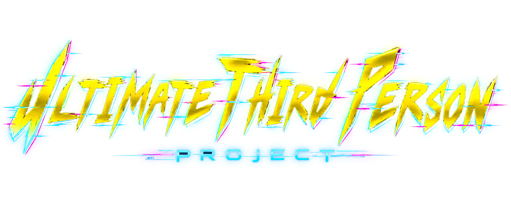
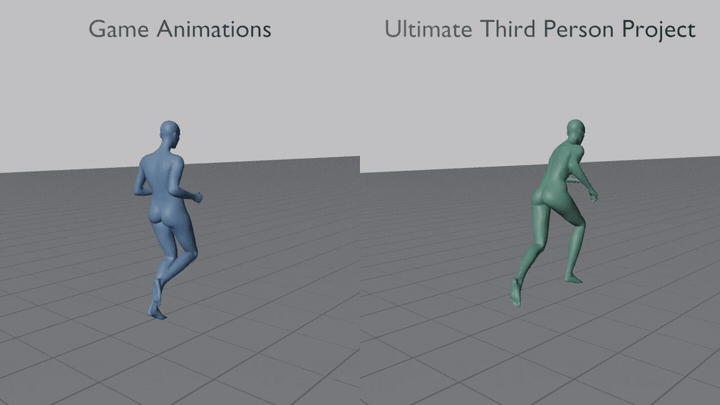
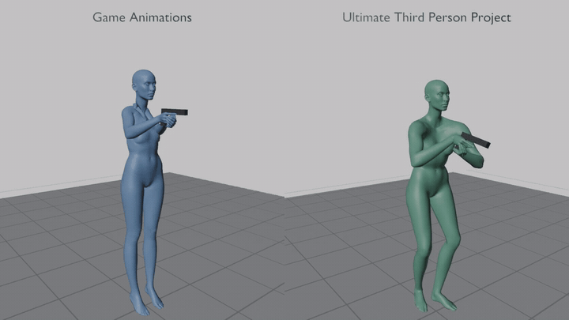
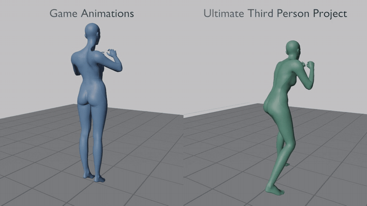

  

<b>Smoothest. Most responsive. Most immersive.</b> 
Motion Matching locomotion, natural body rotation and sharp third-person aiming and combat for Cyberpunk 2077.

  
  
  

  
  
  
  
  
  

  <a href="README.pl.md">Polski</a> · <b>English</b> ·
  <a href="#quick-start">Quick start</a> ·
  <a href="#whats-new-in-020">What's new</a> ·
  <a href="#see-the-difference">See the difference</a> ·
  <a href="#features">Features</a> ·
  <a href="#requirements">Requirements</a> ·
  <a href="#how-to-report-a-problem">Report a problem</a> ·
  <a href="CHANGELOG.md">Changelog</a> ·
  <a href="#for-developers">For developers</a>

## Quick start

> [!NOTE]
> Version 0.2.0 reworks the on-foot movement: how animations are picked and timed, starts, stops, turns and dodges, feet placed on uneven ground, a much lighter lean, and aiming and turning behaviour. The settings of the mod are reset to their new defaults once when you update. It is still an early version; see the [changelog](CHANGELOG.md). Work on 0.2.5, focused on locomotion and traversal, is already under way. Feedback is very welcome.

1. Install the [requirements](#requirements): RED4ext, redscript, Cyber Engine Tweaks, Codeware, ArchiveXL and Input Loader.
2. Install UTPP with Vortex (**Mod manager download**) or extract the archive into the game folder.
3. Start the game and load a save. V is now in third person.
4. Optional: tune it in **Mod Settings > Ultimate Third Person**.

## What's new in 0.2.0

The motion-matching databases are the same as in 0.1.2. Version 0.2.0 changes how the animations are picked, timed and blended, and how the feet and the aim are corrected. The full list is in the [changelog](CHANGELOG.md).

- **Animation selection:** it behaves more like a full motion-matching reference, with more protection against animations flickering between each other.
- **Playback speed:** on the ground the movement animations follow V's actual speed to reduce foot sliding, and the movement predicted for picking animations is shaped for starts, stops, gait changes, turns, strafing, crouching, aiming, stairs, jumps and landings.
- **Stride matching:** V's steps are shortened to her speed in the walking, running and crouched movement loops.
- **Feet:** planted feet are held more firmly in turns and stops and keep their direction, and the pivot foot stays in place in turns on the spot. Feet are placed on slopes, steps, stairs and curbs, with the hips lowered as needed. These are menu options, on by default. **Fit steps to stairs** (shorter, quicker steps at the same speed) is opt-in and off by default.
- **Turns, stops and dodges:** in 180-degree turns on the move V's body turns the same way as the turn animation, the knees follow the direction of the hips, stops overshoot less, and sprinting into a wall holds the idle pose instead of flickering between turn animations. Dodges take their direction relative to the character rather than the turned body, the dodge animation is turned towards the travel direction (up to 90 degrees) and the direction warping no longer twists V's body during it.
- **Crouch:** crouched movement plays at V's actual speed, with changes to the choice of the crouched stop and to the feet at the end of it.
- **Lean:** much lighter by default, now also with a weapon drawn, while aiming (body only) and while crouched. In Shooter mode and while facing the aim it follows V's own sideways acceleration, so she no longer rolls along the wrong axis.
- **Walking and gamepad:** the walk toggle moves V at 1.9 m/s. **On a gamepad this changes how fast V moves:** by default, a stick pushed less than about two thirds of the way gives a steady walk, further gives a full run, and crouching always uses the full crouch speed. Choose **Follows the stick** to get the analog speed back.
- **Aiming:** the barrel is also corrected sideways towards the crosshair, the upper body is steadier while V turns and during camera jerks, a change of direction while aiming and moving can play a turn animation from a smaller angle, and quick left and right taps stay on turn-step animations with firmer feet. The supporting hand stays on two-handed weapons and the pistol, for example in an aimed slide or while crouched. Moving forward while aiming is faster (3.85 m/s, was 3.3), with sideways and backwards movement scaled to it.
- **Natural body turn while aiming on the move:** after V has turned to the crosshair, her legs and hips keep their own direction and turn with her steps, while the upper body and the weapon stay on the crosshair.
- **Head follows the camera:** in Shooter mode and while strafing without aiming, V's head and neck turn and tilt towards where the camera looks (up to 45 degrees to the side), then the upper body follows.
- **Weapons and Shooter mode:** drawing, holstering or changing the weapon type blends into the new weapon pose without overshooting; if the mod pauses itself to protect the frame rate while a ranged weapon is drawn, the weapon pose is kept. Shooter mode (still off by default) holds each direction animation for a minimum time, to reduce back-and-forth changes.
- **Camera and elevators:** curbs and stair steps should no longer switch the camera into its fast-fall mode, and in elevators and on moving platforms V should no longer play jump or fall animations, and the camera and body height should ride with the cabin.
- **Menu:** the lists in Mod Settings should now show a readable label for every value.

### New and changed settings

In **Mod Settings > Ultimate Third Person**:

- **General > Head follows the camera** - new, on by default.
- **Camera > Walk speed (m/s)** - speed with the walk toggle; default 1.9 (was 1.6).
- **Camera > Stride matching** - new, on by default.
- **Camera > Firm feet in turns and stops** - new, on by default.
- **Camera > Feet on uneven ground** - new, on by default.
- **Camera > Fit steps to stairs** - new, **off** by default; needs Feet on uneven ground and Stride matching.
- **Camera > Planted feet keep their direction** - new, on by default.
- **Camera > Firm pivot foot in turns on the spot** - new, on by default; needs Firm feet in turns and stops.
- **Camera > Natural body turn while aiming on the move** - new, on by default.
- **Camera > Body lean** and **Head lean** - new on this page; default 0.2 each (the lean strength was 0.85 for the body and 0.9 for the head before).
- **Advanced > Gamepad stick speed** - new: Walk or run (default) or Follows the stick (the speed changes smoothly with the stick, as in the base game).

The defaults of the other options on this page are unchanged.

## See the difference

Left: the game's own animations. Right: Ultimate Third Person Project. Real-time speed. Recorded with an earlier version of the mod.

| Run, slide, crouch | Aiming and shooting | Fists |
|:---:|:---:|:---:|
|  |  |  |

## Features

| | | |
|:---|:---|:---|
| 🏃 **Motion Matching** Locomotion picked frame by frame from a large animation database. | 🔄 **Body rotation** V turns naturally with the camera and the movement direction. | 🦶 **Foot placement** Foot locking, plus options for firm feet, stride matching and uneven ground. |
| 🎯 **Aiming** The most responsive third-person aiming and shooting in the game. | 🔫 **Recoil and grip** Recoil from the game's weapon animations, left hand on the handguard, stock at the shoulder. | 🥊 **Melee** Fists, knives, katanas, blunt weapons, batons, Mantis Blades and Gorilla Arms in third person, built from the game's own combat animations. |
| 🚗 **Vehicles** Third-person entering and leaving of cars and motorcycles. | ↔️ **Shoulder swap** One key on keyboard and controller, assignable in Mod Settings. | 🎞️ **Animation pack** UTPP animations or the game's own, switchable in the menu. |
| 🩻 **Deformation fixes** Body skin recalculated for the mod's poses, plus targeted corrections for arms and forearms. | ✨ **Smooth transitions** Less snapping and popping between animations. | 🧾 **Diagnostic logs** Built-in logs and a report file for easy problem reports. |

### Current features (work in progress)

- Motion Matching-based locomotion
- Smooth sprint, stop, turn and crouch transitions
- Body rotation during movement
- Camera and movement direction coordination
- Foot-locking support to reduce visible sliding, with options for firm planted feet and a firm pivot foot in turns and stops
- Stride matching: steps shortened to the movement speed in walking, running and crouched movement (menu option)
- Feet placed on slopes, steps, stairs and curbs (menu option); fitting the steps to stairs is opt-in
- Movement animations played at V's actual speed on the ground
- Head follows the camera in Shooter mode and while strafing without aiming
- Adjustable body and head lean into turns
- The most responsive third-person aiming and shooting behavior in Cyberpunk 2077 ever created
- Improved recoil and upper-body animation blending
- Better hand, weapon and reload pose continuity, including a left-hand grip on the rifle handguard and the stock at the shoulder
- Third-person melee combat built from the game's own combat animations: fists, knives, katanas, one-handed and two-handed blunt weapons, batons, Mantis Blades and Gorilla Arms
- A guard stance between strikes, strikes that move the whole body while standing, and crouched melee poses
- Fists: V turns towards the enemy the game tracks when she strikes
- Dual wield (first version): third-person poses, aiming and recoil for two one-handed weapons
- Ground dodges with their own animations, in the direction you press
- Third-person entering and leaving of cars and motorcycles
- A shoulder swap key (keyboard and controller, assignable in Mod Settings)
- Head look: V turns her head and eyes towards where the camera looks while standing or walking
- Body skin recalculated for the mod's poses on both V bodies instead of deforming
- A more feminine figure for female V without a weapon: sloping, set-back shoulders, arms closer to the body (can be switched off)
- V's shadow follows the third-person body, also with ray-traced shadows
- Targeted corrections for arm and forearm deformation
- Reduced snapping and popping during animation transitions
- Your choice of animations: the UTPP animations or the game's own animations with the third-person camera and body kept
- Built-in diagnostic logs for easy problem reports

UTPP combines third-person locomotion, Motion Matching, body rotation, camera coordination, aiming, recoil, weapon handling and animation transitions into one connected framework.

**The goal of UTPP is to create the most complete third-person experience possible for Cyberpunk 2077,** with movement, animation, camera behavior and combat working together naturally.

Long term, the project aims to support entire story animations, motion-matching locomotion and all major combat systems, including firearms, melee weapons, blades, fists, cyberware and other combat interactions.

The aim is not simply to make combat visible from behind V, but to make every combat system feel properly designed for third person.

**UTPP is still actively developed.** Many poses, weapons, body states and transitions still require further refinement, but the foundation is already working and continuously improving.

**If you want to help shape the Ultimate Third Person Project for Cyberpunk 2077, download UTPP, try it in your setup and share your feedback.**

## Animation pack

Choose the animations in **Mod Settings > Ultimate Third Person > General > Animation pack**.

- **Ultimate Third Person Project** (default) - the animations of this mod for movement, aiming, reload, melee and vehicles.
- **Game Animations** - the animations of the game itself on the third-person body. The third-person camera, the full body, the head, the crosshair and the shoulder key stay. The mod's movement, weapon poses, recoil, hand grip, shoulder and lean corrections, traversal, the authored reload, the melee clips, the vehicle entry and exit clips and Shooter mode are switched off, and the options that depend on them have no effect. V turns with the camera, as in the game.

The change works at once while V stands idle. Melee, vehicle and reload animations change at the next weapon draw, vehicle entry or reload. While V reloads, aims, fights, climbs, drives or is in a scene, the change waits until it ends. Your other settings are kept and come back when you return to the UTPP animations. The mod's archives stay installed and still replace some game resources with this pack; their UTPP entries are inactive then.

The game's animations were made for the first-person body, so with Game Animations the arm and shoulder deformations of those animations can come back - they are what the UTPP animations correct.

## Requirements

The following requirements are needed for UTPP to work correctly.

**Required game version**

- **Cyberpunk 2077 version 2.5**
- **Phantom Liberty expansion**

> [!IMPORTANT]
> UTPP is made for game version 2.5 with Phantom Liberty. Older game versions are not supported.

**Required frameworks and supporting mods**

- **RED4ext 1.31.1** - loads the main UTPP plugin.
- **redscript 0.5.32** - required for UTPP scripts.
- **Cyber Engine Tweaks 1.38.1** - provides settings, camera, body and vehicle logic used by UTPP.
- **Codeware 1.21.4** - provides API extensions used by UTPP scripts.
- **ArchiveXL 1.28.8** - provides additional animation and archive support used by UTPP.
- **Input Loader** (version 0.2.6) - provides the shoulder swap key; everything else works without it.
- **Mod Settings** (recommended, version 0.2.30) - the Ultimate Third Person page of the game's settings screen.

> [!WARNING]
> UTPP 0.2.0 is made for the versions listed above; the requirements are the same as for 0.1.2. Older versions will not work with game version 2.5. Newer versions may work, but compatibility is not guaranteed until tested.

Please install and update the required frameworks before reporting an issue with UTPP.

Do not use outdated, duplicate or mixed versions of the required frameworks. If the game fails to start or UTPP does not load, first verify that all dependencies are installed correctly and are compatible with your game version.

## Installation instructions

<b>Vortex installation</b>

1. Open the Files section on the [UTPP Nexus Mods page](https://www.nexusmods.com/cyberpunk2077/mods/35614).
2. Click **Mod manager download**.
3. In Vortex, install and enable UTPP.
4. Deploy your mods if Vortex asks you to do so.
5. Launch Cyberpunk 2077 and load your save.
6. Have fun!

<b>Manual installation</b>

1. Open the Files section on the [UTPP Nexus Mods page](https://www.nexusmods.com/cyberpunk2077/mods/35614).
2. Click **Manual download**.
3. Open the downloaded archive.
4. Extract the contents of the downloaded folder into your Cyberpunk 2077 game folder.
5. Keep the folder structure from the archive unchanged.
6. Launch Cyberpunk 2077 and load your save.
7. Have fun!

> [!CAUTION]
> When updating UTPP, remove obsolete files only when instructed by the release notes. Do not mix files from different UTPP versions.

**Updating to 0.2.0:** install 0.2.0 over the version you have and let it replace every file. No file of an older version has to be removed. Coming from any 0.1.x version, the settings of the mod are reset to their defaults once at the first start, because 0.2.0 changes the movement and its defaults; a message on the screen tells you when it happened. A fresh install shows no message. The two "Swap shoulder" controls are not changed. This happens once: afterwards your settings are kept as before.

Always keep a backup of your mod setup before installing or updating UTPP.

## Troubleshooting

> [!TIP]
> Switch **Animation pack** to **Game Animations** to see whether a problem comes from the UTPP animations or from something else.

<b>If UTPP does not appear to work</b>

- Make sure Cyberpunk 2077 is running the supported version.
- Make sure Phantom Liberty is installed.
- Check that all required frameworks are installed and enabled.
- Make sure Vortex has deployed the installed mods.
- Check that no older UTPP files remain from a previous version.
- Restart the game after installing or updating dependencies.
- Test UTPP without other third-person, animation or combat-overhaul mods if you suspect a conflict.

If the game crashes or behaves unexpectedly after an update, temporarily disable UTPP and verify that the required frameworks work correctly on their own before reinstalling the mod.

## How to report a problem

<b>Use the built-in diagnostic logs</b>

1. Open **Mod Settings > Ultimate Third Person > General > Diagnostic logs** and choose **On for 5 minutes**. A message on the screen tells you that the logs are on.
2. Repeat the problem in the game. The logs run for 5 minutes of gameplay (the time does not run in menus or on the pause screen) and switch themselves off. You can also set the list back to **Off** earlier. A message on the screen tells you when the logs are off and names the report file.
3. Open the folder `red4ext\logs` in the game folder. The file `utpp-report-(date).txt` lists the files to send. Zip those files and send them with a short description of what happened.

The logs contain no personal data: paths are written relative to the game folder, without your Windows user name.

**On until switched off** keeps the logs on, also after a game restart. Use it only for long test sessions and switch it off when you are done (the pose recording then keeps the last 10 minutes).

**When reporting a problem, also include:**

- Your Cyberpunk 2077 version
- Your UTPP version
- Your installed framework versions
- Your character and weapon setup
- The movement or combat state in which the issue occurred
- A screenshot or video whenever possible

Clear and reproducible reports are especially helpful when the problem only occurs with a specific weapon, pose, movement state or installed mod combination.

## Compatibility

<b>Details</b>

UTPP may interact with other mods that modify:

- Camera behavior
- Player locomotion
- Animation graphs
- Aiming and shooting
- Recoil
- Weapon handling
- Reload animations
- Body deformation
- Combat transitions

Compatibility with every existing mod cannot be guaranteed. If another mod changes the same systems as UTPP, disable it temporarily and test again before reporting an issue.

UTPP replaces three animation graphs of the base game: `player_melee.animgraph` (the parried clip is picked per attack; file `utpp_melee_parried_graph.archive`, new in 0.1.1) and `player_ranged.animgraph` and `weapon.animgraph` (the optional authored reload of the Nue pistol; file `utpp_nue_reload.archive`). Mods that replace the same graphs conflict with these files.

For the best troubleshooting results, test UTPP with the required dependencies and without additional third-person, animation or combat-overhaul mods. After confirming that UTPP works correctly, re-enable other mods one at a time to identify possible conflicts.

## Known limitations

<b>Details</b>

Version 0.2.0 is the fourth public release of UTPP and still an early version of the project.

Some poses, weapons, body states, story animations and transitions require further refinement. Results may also vary depending on the installed character, weapon and animation setup.

Not every planned feature or combat system is fully implemented yet.

You may still encounter:

- Pose-specific deformation
- Transitions that require additional smoothing
- Differences between standing, crouching and moving states
- Weapon-specific limitations
- Two-handed weapons: the upper body can lean and shift slightly when aiming starts or ends
- Animation behavior affected by other installed mods
- Arm and shoulder deformation when the Game Animations option is used
- Features planned for future releases but not yet fully implemented (for example hammers, the monowire, finishers and takedowns, which keep the game's animations)

The project is being developed in stages, with continued focus on movement quality, animation continuity, body deformation and combat integration.

## Known issues in 0.2.0

<b>Details</b>

These problems are known in version 0.2.0 and are planned to be fixed in the next updates. You do not need to report them. Changes since 0.1.2 are listed in the [changelog](CHANGELOG.md). The list includes the known issues of 0.1.2, which have not all been checked again.

- Climbing or vaulting started right after a jump is often not performed
- Aiming: during camera jerks and fast turns the muzzle can trail the crosshair a little more, because the aim is smoothed
- Head follows the camera: V's neck can deform more, mainly with male V (the option can be switched off); the lean in more states adds a little to this
- Feet: going down stairs a knee can bend sharply for single frames; V can change the leading leg more often when starting to move; some turns and quick aimed left and right taps can show larger foot corrections or sliding, mostly with male V
- Firm feet in turns and stops: male V's turn while running can look slightly worse
- Natural body turn while aiming on the move: the feet can slide more on some starts, and some wide direction changes are handled less well
- Rare game crash a few seconds after loading a save in which V sits on a vehicle; loading again works
- Knife: when the next strike of a combo starts late while V walks, the arms can snap between the two strikes
- Mantis Blades and Gorilla Arms: drawing them plays the game's own animation
- Hammers, the monowire, finishers and takedowns keep the game's animations
- Dual wield is a first version: the reload uses a basic animation and the stance still needs polish
- Feminine figure: it shows while female V stands and moves without a weapon. With a weapon drawn, while climbing or vaulting and in the animations the game plays itself the previous figure is used; the change between the two takes a quarter of a second
- Sniper rifles: aiming through the scope uses the first-person view; after you stop aiming the view stays in first person for about a second, and the camera passes through V's body on the way back
- Two-handed weapons: V leans far forward while moving, and some rifle stocks do not reach the shoulder
- Shotguns, sniper and precision rifles and heavy machine guns have no UTPP recoil animation yet
- Reloads: in some rifle reloads the elbow of the supporting arm can swing sharply for a single frame
- Head look: with the camera far behind V's shoulder the head turns close to its limit and can look stiff
- Sprint dashes use short dodge animations and can look stiff
- Steps in the terrain higher than about 30 cm can interrupt the run animation for a moment
- Vaulting or sliding over a car hood with a weapon drawn: the upper body can lean back
- Vehicles: when leaving some cars the lower leg can dip into the door sill and the pose can shift briefly
- Motorcycle in the first-person camera: the arms and torso can look distorted
- Scenes and dialogues stay in third person by default and play the game's own animations, which were made for the first-person view: V's body can look distorted in some of them. Switch on "First person in scenes and dialogues" to see them in first person

## Shout outs

Special thanks to the Cyberpunk 2077 modding community and to everyone creating tools, documentation, research and resources that make projects like UTPP possible.

Thanks to the creators of the licensed animation content and the technical references behind UTPP (see [License and credits](#license-and-credits)).

**Thank you to everyone who downloads UTPP, tests it, reports issues, shares feedback or supports the project. Your support helps make continued development possible.**

# For developers

## Repository layout

- `plugin/UTPP/` - the mod itself.
  - `src/` - the RED4ext plugin (`UTPP.dll`, C++20, Windows/MSVC).
  - `scripts/` - redscript (`.reds`) game scripts.
  - `cet/` - Cyber Engine Tweaks mods (Lua).
  - `archive/`, `archive-src/`, `input/` - ArchiveXL resources and the Input Loader key definition.
  - `tests/` - offline tests of the plugin logic.
- `tools/` - Python tools (with a few PowerShell helpers) for animation processing, data baking, testing, installation and release packaging.
- `ue/` - Unreal Engine export scripts.

## AI disclosure

<b>Details</b>

UTPP is designed and directed by its author. Generative AI was used in its making:

- Code: most of the plugin, scripts and tools were written with AI coding agents under the author's direction
- Animation: some transition, vehicle-exit and melee clips were generated locally with NVIDIA Kimodo and MotionBricks
- Mod page: the logo, the trailer and the mod page description were made with the help of AI
- Not used in the mod: AI voices, AI textures or AI translations. The Polish README was translated with AI assistance.
- Nothing in the download is taken or derived from other mods without permission or a license

## License and credits

Ultimate Third Person Project is (c) Daniel Maciej Pytel. All rights reserved except where a third-party license says otherwise.

- **Animation data.** The motion-matching databases, overlays, traversal and lean tables shipped with UTPP are original work. They are based on licensed GASPALS 1.2 content by Polygon Hive, then heavily modified, extended, tuned and blended with the game's own animations for Cyberpunk 2077. The GASPALS content was used under a purchased license.
- **Generated clips.** Some transition, vehicle-exit and melee animation clips were generated locally with NVIDIA Kimodo and NVIDIA MotionBricks (models licensed by NVIDIA Corporation under the NVIDIA Open Model License and the NVIDIA Open Model Agreement, respectively). No NVIDIA model is included.
- **Content derived from Cyberpunk 2077.** Weapon recoil profiles and animation clips, graphs and resource patches built from or for the animations and resources of Cyberpunk 2077 and its Phantom Liberty expansion (c) CD PROJEKT RED are derived from game content. They do not contain the game and work only together with a legitimate copy of it.
- **Open-source code (MIT)** used in `UTPP.dll`: RED4ext.SDK (c) 2020 - present Octavian Dima (plugin API headers); cyberpunk-vr-port (c) 2026 dariulone (logic and memory offsets for arming the player animation were adapted from it); Motion-Matching (c) 2021 Daniel Holden (inertialization and motion matching algorithms re-implemented from it). The full license texts are in [`THIRD_PARTY_NOTICES.txt`](THIRD_PARTY_NOTICES.txt) and ship with every release.

Not affiliated with or endorsed by CD PROJEKT RED, Epic Games, Polygon Hive or NVIDIA.

## Author

Daniel Maciej Pytel
