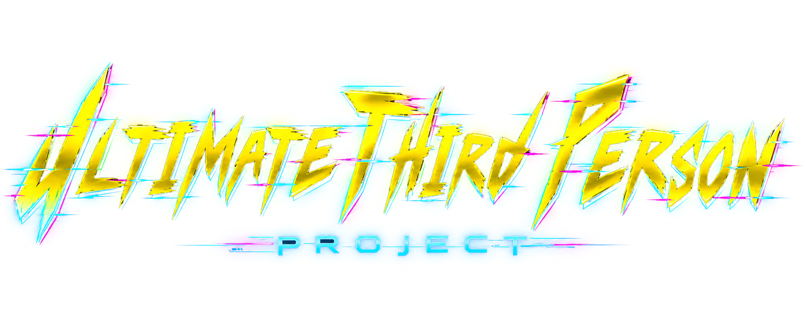
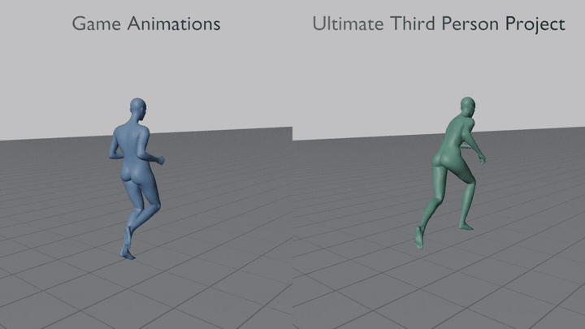
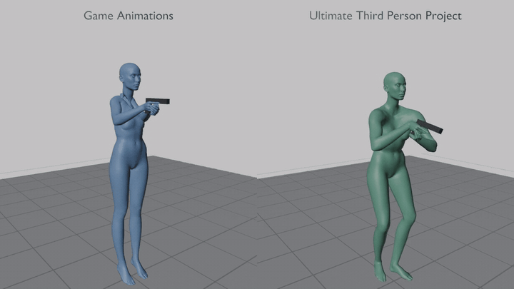
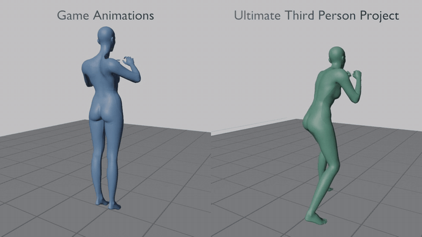

  

<b>Płynność. Responsywność. Immersja.</b> 
Lokomocja oparta na Motion Matching, naturalne obroty ciała oraz precyzyjne celowanie i walka w trzeciej osobie w Cyberpunk 2077.

  
  
  

  
  
  
  
  
  

  <b>Polski</b> · <a href="README.md">English</a> ·
  <a href="#szybki-start">Szybki start</a> ·
  <a href="#zobacz-różnicę">Zobacz różnicę</a> ·
  <a href="#funkcje">Funkcje</a> ·
  <a href="#wymagania">Wymagania</a> ·
  <a href="#jak-zgłosić-problem">Zgłoś problem</a> ·
  <a href="CHANGELOG.md">Lista zmian</a> ·
  <a href="#dla-programistów">Dla programistów</a>

## Szybki start

> [!NOTE]
> Wersja 0.1.1 dodaje broń do walki wręcz, pierwszą wersję walki dwiema broniami, płynniejszy ruch na klawiaturze oraz liczne poprawki ciała i cieni. To nadal wczesna wersja; zobacz [listę zmian](CHANGELOG.md). Uwagi są bardzo mile widziane.

1. Zainstaluj [wymagane komponenty](#wymagania): RED4ext, redscript, Cyber Engine Tweaks, Codeware, ArchiveXL i Input Loader.
2. Zainstaluj UTPP przez Vortex (**Mod manager download**) albo rozpakuj archiwum do folderu gry.
3. Uruchom grę i wczytaj zapis. V jest teraz widoczna w trzeciej osobie.
4. Opcjonalnie dostosuj mod w **Mod Settings > Ultimate Third Person**.

## Zobacz różnicę

Po lewej: oryginalne animacje gry. Po prawej: Ultimate Third Person Project. Nagrania w rzeczywistym tempie.

| Bieg, ślizg, kucanie | Celowanie i strzelanie | Pięści |
|:---:|:---:|:---:|
|  |  |  |

## Funkcje

| | | |
|:---|:---|:---|
| 🏃 **Motion Matching** Animacje ruchu dobierane klatka po klatce z dużej bazy. | 🔄 **Obroty ciała** V naturalnie obraca się wraz z kamerą i kierunkiem ruchu. | 🦶 **Blokowanie stóp** Mniej widocznego ślizgania przy ruszaniu, zatrzymywaniu i skręcaniu. |
| 🎯 **Celowanie** Najbardziej responsywne celowanie i strzelanie w trzeciej osobie w grze. | 🔫 **Odrzut i chwyt broni** Odrzut z animacji broni w grze, lewa dłoń na łożu, kolba przy ramieniu. | 🥊 **Walka wręcz** Pięści, noże, katany, broń obuchowa, pałki, Ostrza Modliszkowe i Ręce Goryla w trzeciej osobie, oparte na oryginalnych animacjach walki z gry. |
| 🚗 **Pojazdy** Wsiadanie do samochodów i na motocykle oraz wysiadanie w trzeciej osobie. | ↔️ **Zmiana ramienia kamery** Jeden klawisz na klawiaturze i padzie, przypisywany w Mod Settings. | 🎞️ **Pakiet animacji** Animacje UTPP lub oryginalne animacje gry, przełączane w menu. |
| 🩻 **Poprawki deformacji** Skóra ciała przeliczana dla póz moda oraz dodatkowe korekty ramion i przedramion. | ✨ **Płynne przejścia** Mniej nagłych przeskoków między animacjami. | 🧾 **Logi diagnostyczne** Wbudowane logi i plik raportu ułatwiają zgłaszanie problemów. |

### Obecne funkcje (prace w toku)

- Lokomocja oparta na Motion Matching
- Płynne przejścia między sprintem, zatrzymaniem, obrotem i kucaniem
- Obroty ciała podczas ruchu
- Koordynacja kierunku kamery i ruchu
- Blokowanie stóp ograniczające widoczne ślizganie
- Najbardziej responsywne celowanie i strzelanie w trzeciej osobie, jakie dotąd powstało dla Cyberpunk 2077
- Ulepszony odrzut i mieszanie animacji górnej części ciała
- Lepsza ciągłość ułożenia dłoni, broni i przeładowania, w tym chwyt łoża lewą dłonią i kolba przy ramieniu
- Walka wręcz w trzeciej osobie oparta na oryginalnych animacjach gry: pięści, noże, katany, jednoręczna i dwuręczna broń obuchowa, pałki, Ostrza Modliszkowe i Ręce Goryla
- Pozycja gardy między ciosami, ciosy poruszające całym ciałem podczas stania i pozy walki wręcz w kucki
- Pięści: podczas uderzenia V obraca się w stronę przeciwnika śledzonego przez grę
- Walka dwiema broniami (pierwsza wersja): pozy, celowanie i odrzut w trzeciej osobie dla dwóch broni jednoręcznych
- Uniki na ziemi z własnymi animacjami, w kierunku wskazanym przez gracza
- Wsiadanie do samochodów i na motocykle oraz wysiadanie w trzeciej osobie
- Klawisz zmiany ramienia kamery (klawiatura i pad, przypisywany w Mod Settings)
- Ruch głowy: V obraca głowę i oczy w kierunku, w którym patrzy kamera, podczas stania lub chodzenia
- Skóra obu wariantów ciała V przeliczana pod pozy moda, aby ograniczyć deformacje
- Cień V podąża za ciałem w trzeciej osobie, także przy cieniach ray tracing
- Ukierunkowane korekty deformacji ramion i przedramion
- Ograniczone nagłe przeskoki między animacjami
- Wybór animacji: animacje UTPP albo oryginalne animacje gry z zachowaniem kamery w trzeciej osobie i widocznego ciała
- Wbudowane logi diagnostyczne ułatwiające zgłaszanie problemów

UTPP łączy lokomocję w trzeciej osobie, Motion Matching, obroty ciała, koordynację kamery, celowanie, odrzut, obsługę broni i przejścia animacji w jeden powiązany system.

**Celem UTPP jest stworzenie możliwie najbardziej kompletnego doświadczenia trzecioosobowego w Cyberpunk 2077,** w którym ruch, animacje, kamera i walka współpracują naturalnie.

Docelowo projekt ma obsługiwać pełne animacje fabularne, lokomocję Motion Matching i wszystkie główne systemy walki, w tym broń palną, walkę wręcz, ostrza, pięści, cyberwszczepy oraz pozostałe interakcje bojowe.

Celem nie jest jedynie pokazanie walki zza pleców V, lecz sprawienie, by każdy system walki był odpowiednio zaprojektowany pod perspektywę trzecioosobową.

**UTPP jest nadal aktywnie rozwijany.** Wiele póz, broni, stanów ciała i przejść wymaga dalszego dopracowania, ale fundament już działa i jest stale ulepszany.

**Jeśli chcesz pomóc w rozwoju Ultimate Third Person Project dla Cyberpunk 2077, pobierz UTPP, sprawdź go w swojej konfiguracji i podziel się uwagami.**

## Pakiet animacji

Wybierz animacje w **Mod Settings > Ultimate Third Person > General > Animation pack**.

- **Ultimate Third Person Project** (domyślnie) — animacje tego moda dla ruchu, celowania, przeładowania, walki wręcz i pojazdów.
- **Game Animations** — oryginalne animacje gry na ciele widocznym w trzeciej osobie. Kamera trzecioosobowa, całe ciało, głowa, celownik i klawisz zmiany ramienia pozostają aktywne. Ruch moda, pozy broni, odrzut, chwyt dłoni, korekty barków i pochylenia, pokonywanie przeszkód, autorskie przeładowanie, animacje walki wręcz, wsiadania i wysiadania oraz tryb Shooter zostają wyłączone, a zależne od nich opcje nie mają działania. V obraca się wraz z kamerą, tak jak w grze.

Zmiana działa od razu, gdy V stoi bezczynnie. Animacje walki wręcz, pojazdów i przeładowania zmieniają się przy następnym wyjęciu broni, wejściu do pojazdu lub przeładowaniu. Gdy V przeładowuje, celuje, walczy, wspina się, prowadzi pojazd lub uczestniczy w scenie, zmiana czeka do zakończenia tej czynności. Pozostałe ustawienia są zachowane i wracają po ponownym wybraniu animacji UTPP. Archiwa moda pozostają zainstalowane i nadal zastępują część zasobów gry także z tym pakietem; ich wpisy UTPP są wtedy nieaktywne.

Oryginalne animacje gry powstały dla ciała pierwszoosobowego, dlatego przy Game Animations mogą wrócić deformacje ramion i barków — to właśnie je korygują animacje UTPP.

## Wymagania

Poniższe wymagania są potrzebne do poprawnego działania UTPP.

**Wymagana wersja gry**

- **Cyberpunk 2077 w wersji 2.5**
- **Dodatek Phantom Liberty**

> [!IMPORTANT]
> UTPP jest przeznaczony do gry w wersji 2.5 z Phantom Liberty. Starsze wersje gry nie są obsługiwane.

**Wymagane frameworki i mody pomocnicze**

- **RED4ext 1.31.1** — ładuje główny plugin UTPP.
- **redscript 0.5.32** — wymagany przez skrypty UTPP. Na razie nie używaj redscript 1.0.0: skrypty UTPP kompilują się z nim od wersji 0.1.1, ale frameworki potrzebne UTPP nie były gotowe w chwili przygotowania tego wydania, dlatego ta wersja nie jest obsługiwana.
- **Cyber Engine Tweaks 1.38.1** — udostępnia logikę ustawień, kamery, ciała i pojazdów wykorzystywaną przez UTPP.
- **Codeware 1.21.4** — udostępnia rozszerzenia API używane przez skrypty UTPP.
- **ArchiveXL 1.28.8** — zapewnia dodatkową obsługę animacji i archiwów wykorzystywaną przez UTPP.
- **Input Loader** (sprawdzono z 0.2.6) — zapewnia klawisz zmiany ramienia kamery; pozostałe funkcje działają bez niego.
- **Mod Settings** (zalecany, sprawdzono z 0.2.30) — strona Ultimate Third Person w ustawieniach gry.

> [!WARNING]
> Powyższe wersje sprawdzono z tym wydaniem. Starsze nie będą działać z grą w wersji 2.5. Nowsze mogą działać, ale ich zgodność nie jest gwarantowana do czasu sprawdzenia.

Zainstaluj i zaktualizuj wymagane frameworki przed zgłoszeniem problemu z UTPP.

Nie używaj przestarzałych, zdublowanych ani wymieszanych wersji wymaganych frameworków. Jeśli gra nie uruchamia się lub UTPP nie zostaje załadowany, najpierw sprawdź poprawność instalacji zależności i ich zgodność z wersją gry.

## Instalacja

<b>Instalacja przez Vortex</b>

1. Otwórz sekcję Files na [stronie UTPP w Nexus Mods](https://www.nexusmods.com/cyberpunk2077/mods/35614).
2. Kliknij **Mod manager download**.
3. Zainstaluj i włącz UTPP w Vortex.
4. Wdróż mody, jeśli Vortex o to poprosi.
5. Uruchom Cyberpunk 2077 i wczytaj zapis.
6. Miłej zabawy!

<b>Instalacja ręczna</b>

1. Otwórz sekcję Files na [stronie UTPP w Nexus Mods](https://www.nexusmods.com/cyberpunk2077/mods/35614).
2. Kliknij **Manual download**.
3. Otwórz pobrane archiwum.
4. Wypakuj zawartość pobranego folderu do katalogu gry Cyberpunk 2077.
5. Zachowaj strukturę folderów z archiwum.
6. Uruchom Cyberpunk 2077 i wczytaj zapis.
7. Miłej zabawy!

> [!CAUTION]
> Przy aktualizacji UTPP usuwaj stare pliki wyłącznie wtedy, gdy nakazuje to opis wydania. Nie mieszaj plików z różnych wersji UTPP.

**Aktualizacja z 0.1.0 do 0.1.1:** zainstaluj 0.1.1 na 0.1.0 i pozwól zastąpić wszystkie pliki. Nie trzeba usuwać żadnego pliku z 0.1.0. Przy pierwszym uruchomieniu 0.1.1 ustawienia moda zostaną jednorazowo przywrócone do domyślnych, ponieważ zmieniły się wartości domyślne i działanie kilku opcji; poinformuje o tym komunikat na ekranie. Dwa przypisania „Swap shoulder” pozostaną bez zmian. Dzieje się to tylko raz — później ustawienia są zachowywane jak wcześniej.

Przed instalacją lub aktualizacją UTPP zawsze zachowaj kopię swojej konfiguracji modów.

## Rozwiązywanie problemów

> [!TIP]
> Zmień **Animation pack** na **Game Animations**, aby sprawdzić, czy problem wynika z animacji UTPP, czy z czegoś innego.

<b>Jeśli UTPP nie działa prawidłowo</b>

- Sprawdź, czy Cyberpunk 2077 ma obsługiwaną wersję.
- Upewnij się, że Phantom Liberty jest zainstalowane.
- Sprawdź, czy wszystkie wymagane frameworki są zainstalowane i włączone.
- Upewnij się, że Vortex wdrożył zainstalowane mody.
- Sprawdź, czy nie pozostały pliki starszych wersji UTPP.
- Po instalacji lub aktualizacji zależności uruchom grę ponownie.
- Przy podejrzeniu konfliktu sprawdź UTPP bez innych modów zmieniających trzecią osobę, animacje lub walkę.

Jeśli po aktualizacji gra się zawiesza lub zachowuje nietypowo, tymczasowo wyłącz UTPP i sprawdź, czy wymagane frameworki działają samodzielnie, zanim ponownie zainstalujesz mod.

## Jak zgłosić problem

<b>Korzystanie z wbudowanych logów diagnostycznych</b>

1. Otwórz **Mod Settings > Ultimate Third Person > General > Diagnostic logs** i wybierz **On for 5 minutes**. Komunikat na ekranie poinformuje o włączeniu logów.
2. Odtwórz problem w grze. Logi zbierają dane przez 5 minut rozgrywki (czas nie płynie w menu ani podczas pauzy), a następnie wyłączają się automatycznie. Możesz też wcześniej ustawić opcję na **Off**. Komunikat poinformuje o wyłączeniu logów i poda nazwę pliku raportu.
3. Otwórz folder `red4ext\logs` w katalogu gry. Plik `utpp-report-(date).txt` zawiera listę plików do wysłania. Spakuj je do ZIP-a i wyślij z krótkim opisem tego, co się wydarzyło.

Logi nie zawierają danych osobowych: ścieżki są zapisywane względem folderu gry, bez nazwy Twojego konta Windows.

**On until switched off** pozostawia logi włączone, także po ponownym uruchomieniu gry. Używaj tej opcji wyłącznie do długich testów i później ją wyłącz; nagrywanie póz zachowuje wtedy ostatnie 10 minut.

**Przy zgłaszaniu problemu podaj również:**

- Wersję Cyberpunk 2077
- Wersję UTPP
- Wersje zainstalowanych frameworków
- Konfigurację postaci i broni
- Stan ruchu lub walki, w którym pojawił się problem
- Zrzut ekranu lub nagranie, jeśli to możliwe

Czytelne i odtwarzalne zgłoszenia są szczególnie pomocne, gdy problem występuje tylko dla określonej broni, pozy, stanu ruchu lub zestawu modów.

## Zgodność z innymi modami

<b>Szczegóły</b>

UTPP może oddziaływać z modami zmieniającymi:

- Działanie kamery
- Lokomocję gracza
- Grafy animacji
- Celowanie i strzelanie
- Odrzut
- Obsługę broni
- Animacje przeładowania
- Deformacje ciała
- Przejścia między stanami walki

Nie można zagwarantować zgodności z każdym modem. Jeśli inny mod zmienia te same systemy co UTPP, tymczasowo go wyłącz i ponów test przed zgłoszeniem problemu.

UTPP zastępuje trzy grafy animacji podstawowej gry: `player_melee.animgraph` (animacja po sparowaniu ciosu dobierana dla każdego ataku; plik `utpp_melee_parried_graph.archive`, nowy w 0.1.1) oraz `player_ranged.animgraph` i `weapon.animgraph` (opcjonalne autorskie przeładowanie pistoletu Nue; plik `utpp_nue_reload.archive`). Mody zastępujące te same grafy kolidują z tymi plikami.

Na potrzeby diagnozy sprawdzaj UTPP z wymaganymi zależnościami, bez dodatkowych modów zmieniających trzecią osobę, animacje lub walkę. Po potwierdzeniu działania UTPP włączaj inne mody pojedynczo, aby znaleźć ewentualne konflikty.

## Znane ograniczenia

<b>Szczegóły</b>

Wersja 0.1.1 to drugie publiczne wydanie UTPP i nadal wczesny etap projektu.

Niektóre pozy, rodzaje broni, stany ciała, animacje fabularne i przejścia wymagają dalszego dopracowania. Efekt może też zależeć od konfiguracji postaci, broni i animacji.

Nie wszystkie planowane funkcje i systemy walki zostały już w pełni wdrożone.

Nadal mogą wystąpić:

- Deformacje w określonych pozach
- Przejścia wymagające dalszego wygładzenia
- Różnice między staniem, kucaniem i ruchem
- Ograniczenia dotyczące konkretnych rodzajów broni
- Broń dwuręczna: górna część ciała może nieznacznie pochylić się i przesunąć na początku lub końcu celowania
- Zmiany działania animacji spowodowane innymi modami
- Deformacje ramion i barków przy użyciu opcji Game Animations
- Funkcje planowane na kolejne wydania, ale jeszcze niewdrożone w pełni (np. młoty, monostruna, finiszery i obalenia, które zachowują oryginalne animacje gry)

Projekt rozwija się etapami, ze stałym naciskiem na jakość ruchu, ciągłość animacji, deformacje ciała i integrację walki.

## Znane problemy w 0.1.1

<b>Szczegóły</b>

Te problemy są znane w wersji 0.1.1 i planowane do poprawy w kolejnych aktualizacjach. Nie musisz ich zgłaszać. Poprawki od wersji 0.1.0 opisano na [liście zmian](CHANGELOG.md).

- redscript 1.0.0 nie jest jeszcze obsługiwany: używaj redscript 0.5.32
- Rzadki crash kilka sekund po wczytaniu zapisu, w którym V siedzi w pojeździe; ponowne wczytanie działa
- Nóż: gdy kolejny cios kombinacji zaczyna się późno podczas chodzenia, ramiona mogą gwałtownie przeskoczyć między ciosami
- Ostrza Modliszkowe i Ręce Goryla: wyjęcie odtwarza oryginalną animację gry
- Młoty, monostruna, finiszery i obalenia zachowują oryginalne animacje gry
- Walka dwiema broniami jest w pierwszej wersji: przeładowanie korzysta z podstawowej animacji, a postawa wymaga dopracowania
- Karabiny snajperskie: celowanie przez lunetę korzysta z widoku pierwszoosobowego; po zakończeniu celowania ten widok utrzymuje się jeszcze przez około sekundę, a kamera wraca do trzeciej osoby przez ciało V
- Broń dwuręczna: V mocno pochyla się do przodu w ruchu, a kolby niektórych karabinów nie sięgają ramienia
- Strzelby, karabiny snajperskie i precyzyjne oraz ciężkie karabiny maszynowe nie mają jeszcze animacji odrzutu UTPP
- Przeładowanie: w niektórych animacjach karabinów łokieć ręki podtrzymującej broń może gwałtownie przeskoczyć na jedną klatkę
- Ruch głowy: gdy kamera jest daleko za ramieniem V, głowa obraca się blisko granicy zakresu i może wyglądać sztywno
- Dash podczas sprintu korzysta z krótkich animacji uników i może wyglądać sztywno
- Stopnie terenu wyższe niż około 30 cm mogą na chwilę przerwać bieg
- Przeskok lub ślizg przez maskę samochodu z wyciągniętą bronią: górna część ciała może odchylić się do tyłu
- Pojazdy: przy wysiadaniu z niektórych samochodów dolna część nogi może wejść w próg, a poza na chwilę się przesunąć
- Motocykl w kamerze pierwszoosobowej: ramiona i tułów mogą wyglądać na zniekształcone
- Sceny i dialogi domyślnie pozostają w trzeciej osobie i odtwarzają oryginalne animacje gry przeznaczone do widoku pierwszoosobowego: w części z nich ciało V może być zniekształcone. Włącz „First person in scenes and dialogues”, aby oglądać je w pierwszej osobie

## Podziękowania

Szczególne podziękowania dla społeczności modderskiej Cyberpunk 2077 i wszystkich twórców narzędzi, dokumentacji, analiz oraz zasobów, dzięki którym projekty takie jak UTPP mogą powstawać.

Dziękuję twórcom licencjonowanych animacji i materiałów technicznych, na których opiera się UTPP (zobacz [Licencję i credits](#licencja-i-credits)).

**Dziękuję każdemu, kto pobiera UTPP, testuje go, zgłasza błędy, dzieli się uwagami lub wspiera projekt. Wasze wsparcie pomaga kontynuować rozwój.**

# Dla programistów

## Struktura repozytorium

- `plugin/UTPP/` — sam mod.
  - `src/` — plugin RED4ext (`UTPP.dll`, C++20, Windows/MSVC).
  - `scripts/` — skrypty gry w redscript (`.reds`).
  - `cet/` — mody Cyber Engine Tweaks (Lua).
  - `archive/`, `archive-src/`, `input/` — zasoby ArchiveXL i definicja klawisza Input Loader.
  - `tests/` — testy offline logiki pluginu.
- `tools/` — narzędzia Python (z pomocnikami PowerShell) do przetwarzania animacji, przygotowania danych, testów, instalacji i pakowania wydań.
- `ue/` — skrypty eksportu z Unreal Engine.

## Wykorzystanie AI

<b>Szczegóły</b>

Projekt UTPP jest opracowywany, kierowany i testowany w grze przez autora. Przy jego tworzeniu korzystano z generatywnej AI:

- Kod: większość pluginu, skryptów i narzędzi napisali agenci programistyczni AI pod kierunkiem autora
- Animacje: część przejść, wysiadania z pojazdów i animacji walki wręcz wygenerowano lokalnie przy użyciu NVIDIA Kimodo i MotionBricks
- Strona moda: logo, zwiastun i opis strony powstały z pomocą AI
- W samym modzie nie wykorzystano głosów, tekstur ani tłumaczeń AI. Polskie README przetłumaczono z pomocą AI.
- Nic w paczce nie pochodzi z innych modów ani nie zostało z nich opracowane bez zgody lub licencji

## Licencja i credits

Ultimate Third Person Project jest objęty prawami autorskimi (c) Daniel Maciej Pytel. Wszelkie prawa zastrzeżone, z wyjątkiem zakresu objętego licencjami zewnętrznymi.

- **Dane animacji.** Dostarczane z UTPP bazy Motion Matching, nakładki, tabele pokonywania przeszkód i pochylenia są autorską pracą. Oparto je na licencjonowanych zasobach GASPALS 1.2 autorstwa Polygon Hive, a następnie znacznie zmodyfikowano, rozszerzono, dostrojono i połączono z oryginalnymi animacjami Cyberpunk 2077. Zasoby GASPALS wykorzystano na podstawie zakupionej licencji.
- **Wygenerowane animacje.** Część przejść, wysiadania z pojazdów i animacji walki wręcz wygenerowano lokalnie przy użyciu NVIDIA Kimodo i NVIDIA MotionBricks (modele na licencjach odpowiednio NVIDIA Open Model License i NVIDIA Open Model Agreement, udzielanych przez NVIDIA Corporation). Żaden model NVIDIA nie jest dołączony.
- **Materiały pochodzące z Cyberpunk 2077.** Profile odrzutu broni i animacje, grafy oraz poprawki zasobów opracowane z animacji i zasobów Cyberpunk 2077 oraz dodatku Phantom Liberty (c) CD PROJEKT RED albo na ich potrzeby wywodzą się z zawartości gry. Nie zawierają gry i działają wyłącznie z jej legalną kopią.
- **Kod open source (MIT)** używany w `UTPP.dll`: RED4ext.SDK (c) 2020 – obecnie Octavian Dima (nagłówki API pluginu); cyberpunk-vr-port (c) 2026 dariulone (zaadaptowano logikę i offsety pamięci do uruchamiania animacji gracza); Motion-Matching (c) 2021 Daniel Holden (ponownie zaimplementowane algorytmy inercjalizacji i Motion Matching). Pełne teksty licencji znajdują się w [`THIRD_PARTY_NOTICES.txt`](THIRD_PARTY_NOTICES.txt) i są dołączane do każdego wydania.

Projekt nie jest powiązany z CD PROJEKT RED, Epic Games, Polygon Hive ani NVIDIA i nie jest przez te firmy oficjalnie wspierany.

## Autor

Daniel Maciej Pytel
